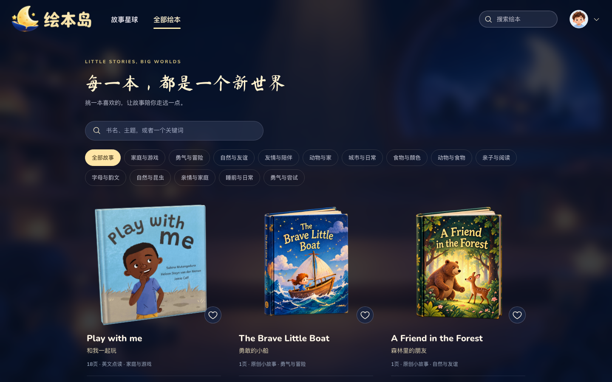
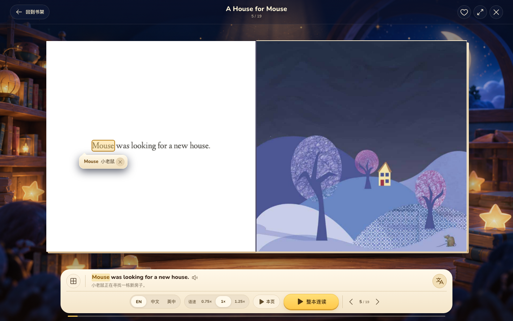

# 互动绘本岛 3.0

### 让英语绘本变成可以边看、边听、边点的阅读体验

面向绘本馆、英语教室和小型教育机构的轻量互动绘本方案。老师整理好新绘本后，可用自己熟悉的 Agent 工具发布为分享链接，再发给学员使用；阅读端不需要复杂的学员账号体系，机构也无需自备服务器和域名。

**演示视频：**[点击观看 3.0 实际界面录屏](media/interactive-picture-books-3.0-demo.mp4)

## 核心阅读体验

- **点单词就能听、就能懂：**点读英语单词并听发音，中文释义显示在单词附近。
- **中英故事朗读：**按页播放英语或中文音轨；新书制作可按故事角色规划不同朗读音色。
- **打开就是绘本：**书架进入阅读页，保留绘本原有的页面阅读体验与轻量互动。
- **记录阅读位置：**在当前浏览器继续上次读到的位置；不依赖学生账号和在线后台。

## 面向机构的交付方式

一次性提供互动绘本阅读前端和绘本制作 Skill。需要增加新书时，按制作规范导入并更新内容包，再由机构用熟悉的 Agent 发布工具重新发布分享链接，老师把新链接发给学员即可。

这套方案适合想快速把绘本资源变成可分享的英语阅读体验的小型机构。当前不提供复杂的学员账号、教师后台或跨设备阅读数据统计。

## 实际界面截图

### 绘本书架

### 点读与词旁释义

## 联系方式

对互动绘本岛 3.0 的交付或合作感兴趣，欢迎联系超哥：

**微信：chaogevision**

## 演示素材说明

演示视频和截图来自绘本岛本地实际运行页面。演示中的《A House for Mouse》原作由 Michele Fry 创作，Amy Uzzell、Jennifer Jacobs 负责插画与设计，来自 Book Dash，采用 [CC BY 4.0](https://creativecommons.org/licenses/by/4.0/) 许可；本版本增加中文翻译和英中朗读。原书：[Book Dash — A House for Mouse](https://bookdash.org/books/a-house-for-mouse/)。
