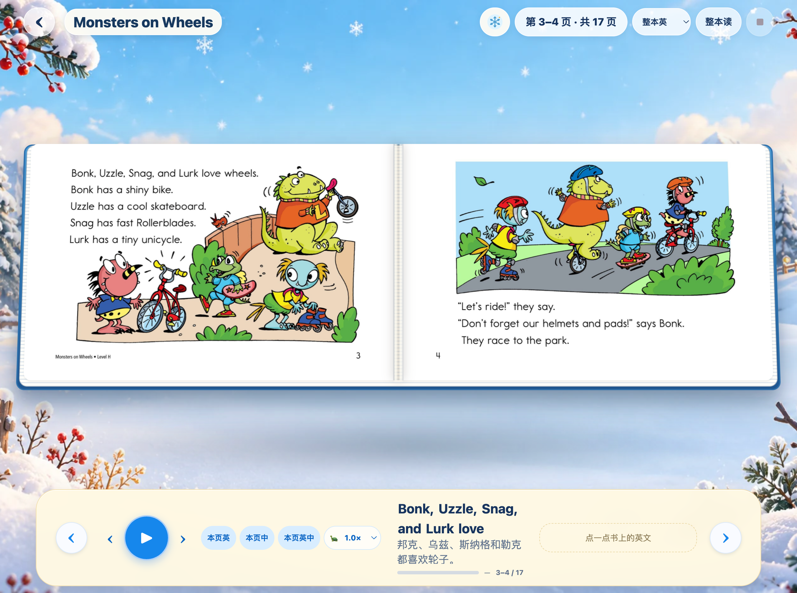

<div align="center">

# TapBook

### 把绘本 PDF，变成可以翻、可以点、可以听的互动绘本

**A reusable Skill for turning picture-book PDFs into interactive, read-along books.**



**示例绘本：** [下载完整 17 页互动样例](examples/monsters-on-wheels-interactive.zip) · [查看样例说明](examples/README.md)

<p>保留原书每一页的绘画与版面，在周围搭起适合孩子阅读的绘本舞台。点单词听发音、看词义；按句朗读；整页或整本中英双语播放。</p>

</div>

---

## TapBook 能做什么

给 Agent 一份绘本 PDF，TapBook 会按书的内容分析主题和版式，再生成一个可直接用浏览器打开的静态互动阅读器：

1. **保留原书**：逐页渲染 PDF，保留原图、文字、页序和比例，不裁切、不重画。
2. **分析整本书**：检查封面、文本、重复元素和代表性内页，选择合适的阅读方式与主题场景。
3. **添加点读**：识别英文单词的位置；点击单词即可听发音，并在底部显示词义。
4. **加入双语朗读**：英语逐词高亮、逐句配中文翻译；可读本句、本页或整本书。
5. **生成本地音频**：构建时使用 Edge TTS 生成并保存音频。阅读时播放本地文件，不需要 TTS 后端。
6. **打包交付**：输出可静态托管的绘本目录和 ZIP，可在手机、平板和电脑上阅读。

### 离线打开成品

1. 将 ZIP **完整解压**到一个文件夹，保持里面的图片、音频和主题目录不变。
2. 双击解压后根目录中的 `index.html`，即可离线阅读；不需要先启动 HTTP 服务。

打包时，TapBook 会把 `book.json` 内嵌到首页中，绕过浏览器对 `file://` 页面读取旁边 JSON 文件的限制；图片和音频仍以随包的本地文件播放。不要直接从 ZIP 预览里打开 `index.html`，也不要把首页单独移出绘本文件夹。旧版压缩包如提示无法载入数据，请用新版 Skill 重新打包。

### 阅读界面预览


这些背景只装饰书页周围的阅读舞台。原书页面仍完整显示在书本中；宽屏平板可并排展示跨页，窄屏会自动切换为单页。

## 内置主题场景

TapBook 附带 9 套可离线切换的主题背景。每套都包含横屏和竖屏构图，阅读器会根据故事主题选一个初始场景，读者也可以随时更换。

<table>
  <tr>
    <td align="center"><br><b>绘本花园</b></td>
    <td align="center"><br><b>冬日雪景</b></td>
    <td align="center"><br><b>交通工具</b></td>
  </tr>
  <tr>
    <td align="center"><br><b>工程车</b></td>
    <td align="center"><br><b>农场动物</b></td>
    <td align="center"><br><b>森林探索</b></td>
  </tr>
  <tr>
    <td align="center"><br><b>海洋世界</b></td>
    <td align="center"><br><b>太空旅行</b></td>
    <td align="center"><br><b>柔和彩色</b></td>
  </tr>
</table>

## 安装

先把仓库克隆到你使用的 Agent 能识别的 Skill 目录。以下示例使用项目级 `.agents/skills/`：

```bash
mkdir -p .agents/skills
git clone https://github.com/chaogevision/tapbook.git .agents/skills/tapbook
```

让当前项目环境安装 Python 依赖：

```bash
python3 -m venv .venv-tapbook
source .venv-tapbook/bin/activate
python -m pip install -r .agents/skills/tapbook/requirements.txt
python -c 'from importlib.metadata import version; print(version("edge-tts"))'
```

TapBook 固定使用 `edge-tts==7.3.1`。复用旧 Python 环境时重新安装 requirements，并确认上面的版本输出为 `7.3.1`。

PDF 渲染和文字识别还需要 Poppler 与 Tesseract：

**macOS**

```bash
brew install poppler tesseract
```

**Debian / Ubuntu**

```bash
sudo apt install poppler-utils tesseract-ocr tesseract-ocr-eng
```
**Windows 10/11 (PowerShell)**

Follow the [Windows setup and verification guide](references/windows-setup.md) for PowerShell commands, Python environment setup, Poppler/Tesseract installation and `PATH` checks, an Edge TTS connectivity smoke test, and the end-to-end reader check. Install English Tesseract data (`eng`) for the default workflow. Invoke the virtual environment's `Scripts\python.exe` directly; no PowerShell activation-policy change is needed.


安装后刷新或重启 Agent 会话，让它发现 `$tapbook`。不同 Agent 的 Skill 目录可能不同；也可以把整个仓库放进该 Agent 支持的 Skills 目录。不要只复制 `SKILL.md`：阅读器、脚本、背景图和校验规则也都在仓库中。

## 使用

给 Agent 附上 PDF，并提出类似请求：

```text
使用 $tapbook，把这本 PDF 制作为适合手机和平板阅读的互动绘本。
保留每一页原图和文字；分析整本书后选择最合适的预设主题。
英文单词需要可点读并显示中文词义；逐句高亮，支持本页和整本的中英双语朗读。
完成 OCR、音频和页面检查后，输出静态绘本目录与 ZIP。
```

TapBook 会按照 `SKILL.md` 中的工作流处理 PDF、制作 `book.json`、生成音频、校验内容并打包。它会明确报告 OCR 或原书页面中无法确认的部分，不会把未检查的页面标记为已核验。

## 朗读与交互

- **点词**：点击原书中的英文单词，播放本地发音，并显示单词及中文词义。
- **句子朗读**：播放当前句，按音频时间逐词高亮原书上的对应文字，并同步显示该句翻译。
- **本页朗读**：支持英语、中文，或按“本页英语 → 本页中文”的顺序双语朗读。
- **整本朗读**：逐页朗读；双语模式每页读完英语后接着读该页中文，再进入下一页。
- **翻页与适配**：支持触控滑动、按钮和键盘翻页；横屏平板显示左右跨页，窄屏显示完整单页。
- **语速调节**：调节单词、句子、页面和整本书朗读速度。

## 构建工具与边界

- Python 3.11 或更新版本
- Poppler：PDF 页面渲染与 PDF 信息读取
- Tesseract：OCR 文字识别（按 PDF 语言安装语言包）
- `edge-tts`：构建期间生成英语和中文音频，需要联网

生成的阅读器包含本地页面图片、主题背景、代码和 MP3 音频，可通过任意静态 HTTP 服务访问，无需部署应用后端。**只有生成音频时需要连接 Microsoft Edge TTS 服务；离线阅读已经生成的绘本不需要请求 TTS。** TTS 的服务可用性和音色可能变化，不能保证长期免费或始终可用。

详细的处理规则见 [`SKILL.md`](SKILL.md)，主题与版式规则见 [`references/theme-and-layout-guide.md`](references/theme-and-layout-guide.md)，验收清单见 [`references/quality-checklist.md`](references/quality-checklist.md)。

## 许可证

TapBook 自有的软件与项目资源（包括源代码、脚本、阅读器界面、内置主题素材和技术文档）采用 [PolyForm Noncommercial 1.0.0](LICENSE)。非商业用途按许可证正文授权；商业用途不在本授权范围内。

**样例绘本除外：** [`examples/monsters-on-wheels-interactive.zip`](examples/monsters-on-wheels-interactive.zip) 中的原书页面、文字和相关绘本素材仅作为经授权公开的演示样例，不包含在 TapBook 的 PolyForm 许可中，也不因此获得复制、改编或商业使用原书内容的权利。详见 [样例内容说明](examples/SAMPLE-CONTENT-NOTICE.txt)。

---

### English

TapBook is an agent Skill that turns a user-provided picture-book PDF into a responsive static reader. It preserves complete source pages, analyzes the book before choosing one of nine bundled raster themes, makes English words tappable, aligns Chinese translations with sentence-level narration, and packages local Edge TTS audio with the finished book. See [`SKILL.md`](SKILL.md) for the complete workflow and requirements.

The original TapBook software and project materials are licensed under the [PolyForm Noncommercial License 1.0.0](LICENSE). The source-book pages, text, and related assets in the *Monsters on Wheels* sample are excluded and remain subject to their respective rights holders' terms; the sample is provided only as an authorized public demo.
